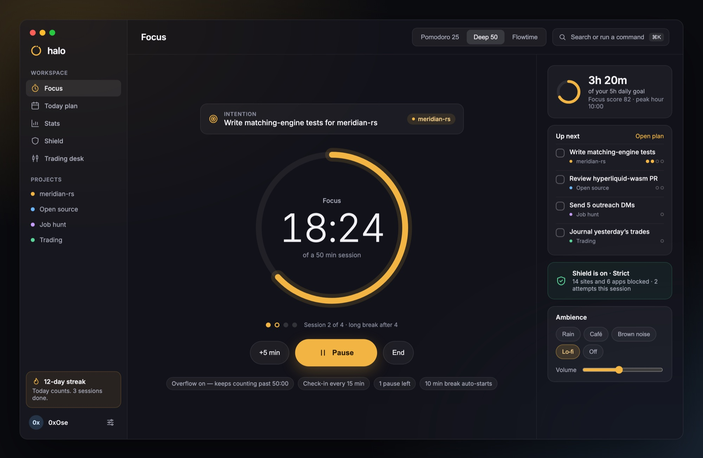
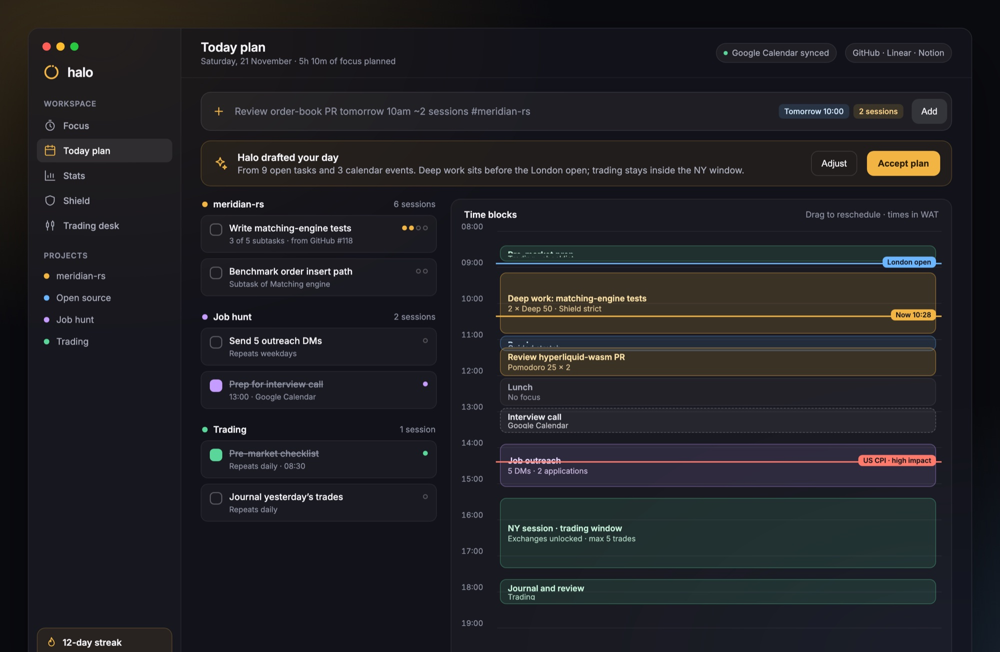
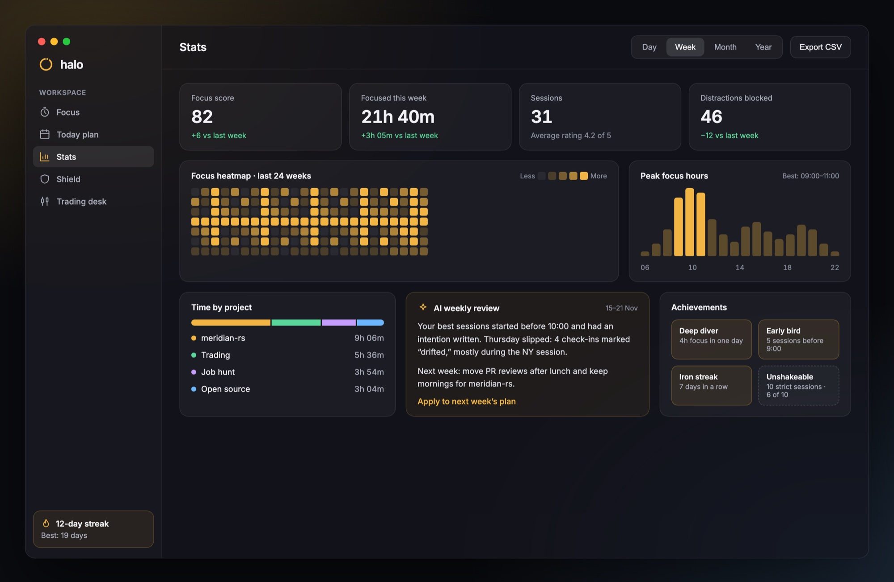
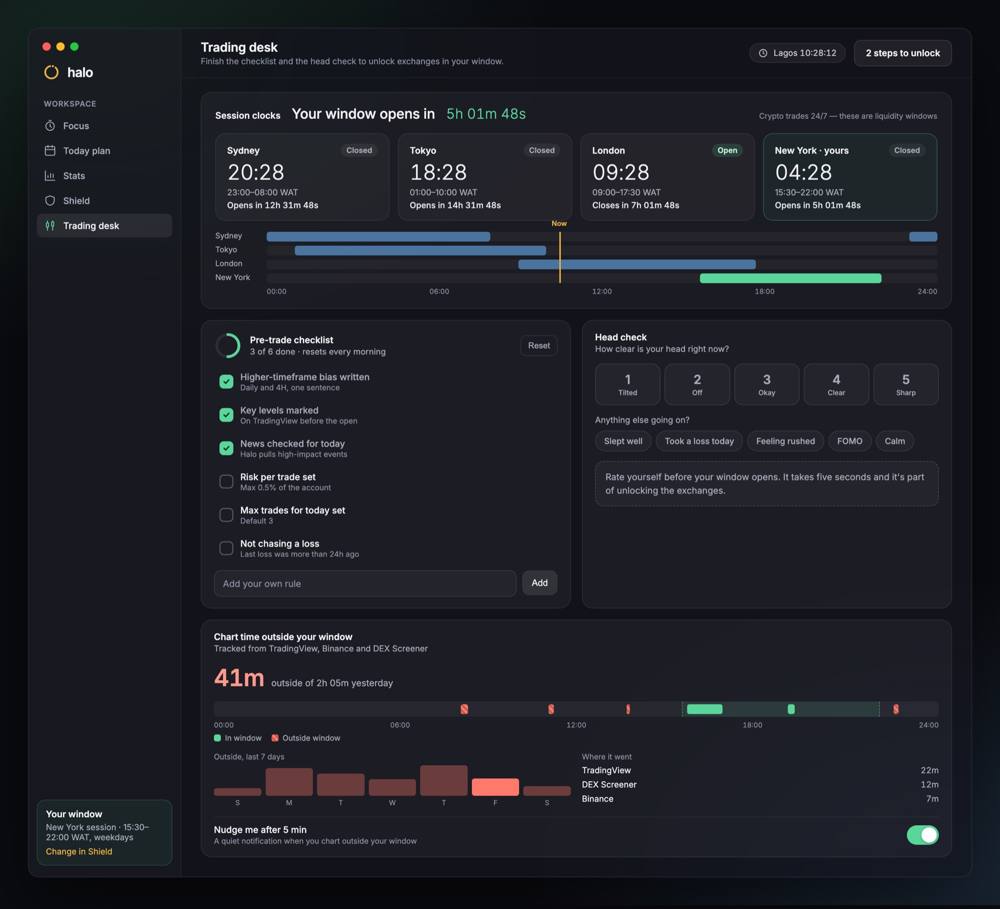
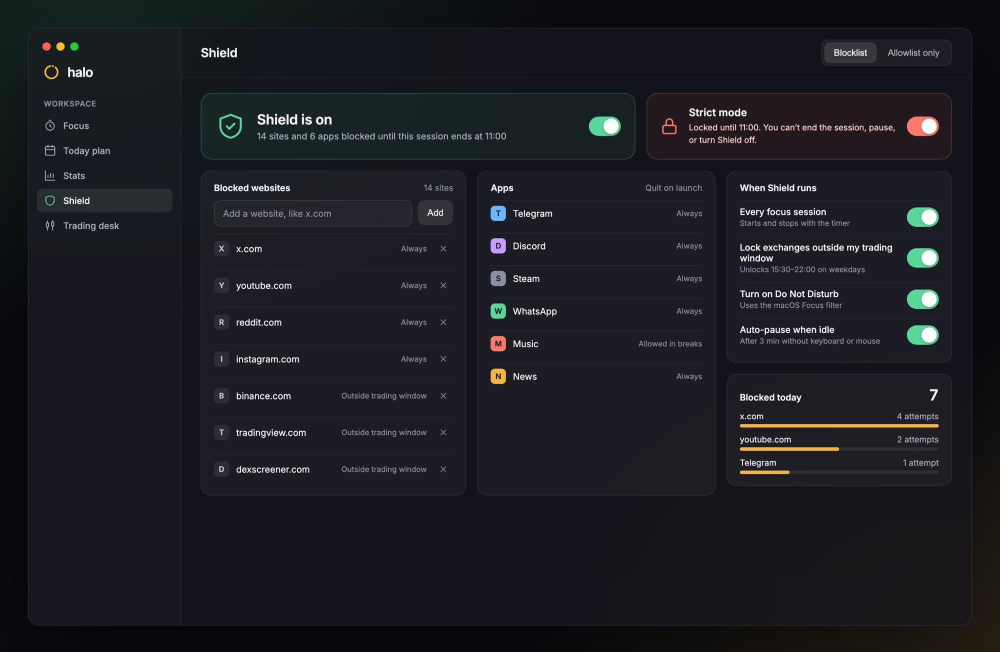
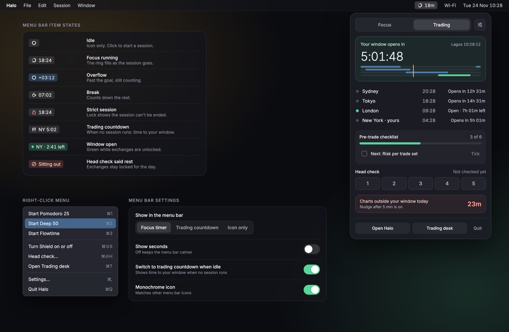
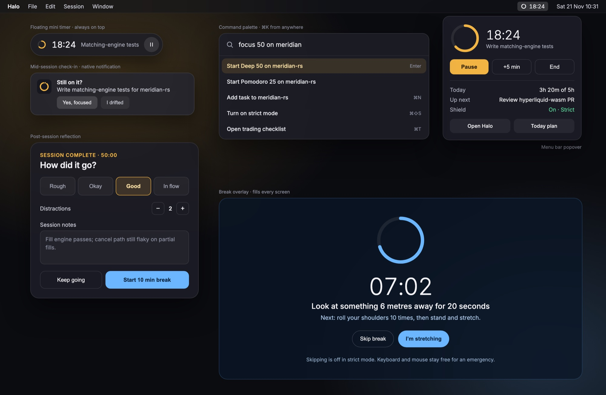
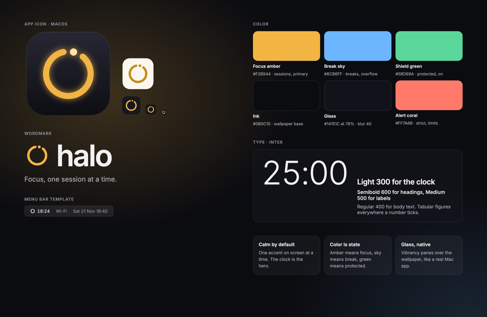

# Halo

A macOS-first focus app: a Pomodoro-style timer, daily planner, distraction
blocker, and a trading-discipline desk. One goal: more deep work, less drift.
Rust core, TypeScript/React UI, Tauri in between.



> **Status: early scaffold.** The workspace, build tooling, typed IPC, and local
> database are in place; the features are not. The app opens one window that
> shows its version and database schema version. Nothing else works yet.

## What it will do (v1)

- **Timer:** Pomodoro 25/5, Deep 50/10, custom presets and Flowtime; overflow
  past the goal; an intention before every session; mid-session check-ins.
- **Planning:** tasks with session estimates, projects, a time-blocked today
  plan, natural-language quick add, calendar sync.
- **Shield:** website and app blocking, allowlist mode, strict mode that can't
  be turned off mid-session, auto Do Not Disturb.
- **Stats:** daily and weekly reports, heatmap, peak hours, focus score, export.
- **Desktop:** menu bar timer and popover, floating mini timer, global hotkeys,
  ⌘K palette, offline-first local storage.
- **Trading desk:** Sydney, Tokyo, London and New York session clocks in your
  time zone; a pre-trade checklist; a "how clear is your head" check; tracking
  of chart time outside your trading window.

Halo never places trades, never holds exchange API keys, and never gives
trading advice. It only manages time, attention, and your own rules.

## Screens

These are designs, rendered from the canvas snapshot in [design/](design/).
The app doesn't have these screens yet.

<table>
  <tr>
    <td width="50%"><br><b>Today plan.</b> Quick add, tasks with session estimates, time blocks.</td>
    <td width="50%"><br><b>Stats.</b> Focus score, heatmap, peak hours, weekly review.</td>
  </tr>
  <tr>
    <td><br><b>Trading desk.</b> Session clocks, checklist, head check, chart time outside your window.</td>
    <td><br><b>Shield.</b> Strict mode, block or allow lists, apps, schedules.</td>
  </tr>
  <tr>
    <td><br><b>Menu bar.</b> Popover, item states, right-click menu, settings.</td>
    <td><br><b>Overlays.</b> Mini timer, check-in, reflection, ⌘K palette, break overlay.</td>
  </tr>
</table>



To regenerate the images after the canvas changes, update `design/` and run
`sh scripts/screenshots/render.sh` (needs Google Chrome).

## How it's built

- **Rust owns state and time.** The timer engine runs in Rust and emits events.
  Every window (main, menu bar, mini timer, overlays) renders from those
  events, so they never disagree. The UI never computes session time.
- **Typed IPC.** Rust commands and types are exported to TypeScript with
  [tauri-specta](https://github.com/specta-rs/tauri-specta), so the two sides
  can't drift.
- **Local first.** Everything lives in a SQLite file in the app data folder.
  Every schema change is a numbered migration.

## Layout

```
apps/
  desktop/          @halo/desktop: the Tauri app (React UI in src/, Rust shell in src-tauri/)
packages/
  core/             @halo/core: TypeScript bindings generated from the Rust commands
  ui/               @halo/ui: design tokens, Tailwind theme, shared components
crates/
  store/            halo-store: SQLite connection and migrations
```

Pure domain logic (timer engine, trading clocks) goes in `crates/` with no
Tauri dependency, so it can be unit-tested on its own.

## Getting started

Requirements: macOS 13 or later, Node 22.12+, pnpm 9, and a stable Rust
toolchain.

```sh
pnpm install          # also enables the git hooks in .githooks/
pnpm dev              # run the app
```

## Development

```sh
pnpm check            # lint, format check, typecheck, UI tests
cargo test            # Rust tests; also regenerates packages/core/src/bindings.ts
cargo clippy --workspace --all-targets -- -D warnings
pnpm tauri build      # release build (.app and .dmg)
```

- **Adding a command:** write it in `apps/desktop/src-tauri/src/commands/`,
  register it in `specta_builder()` in `lib.rs`, run `cargo test`, and commit
  the regenerated `packages/core/src/bindings.ts`. CI fails if that file is
  out of date.
- **Commits** follow [Conventional Commits](https://www.conventionalcommits.org)
  (`feat(timer): overflow mode`); the `commit-msg` hook checks this.

## Releases

Pushing a `v*` tag builds .dmg files for Apple Silicon and Intel and attaches
them to a draft GitHub release. Builds aren't code-signed yet, so macOS warns
on first launch: open the app once, then choose Open Anyway in System
Settings > Privacy & Security.
